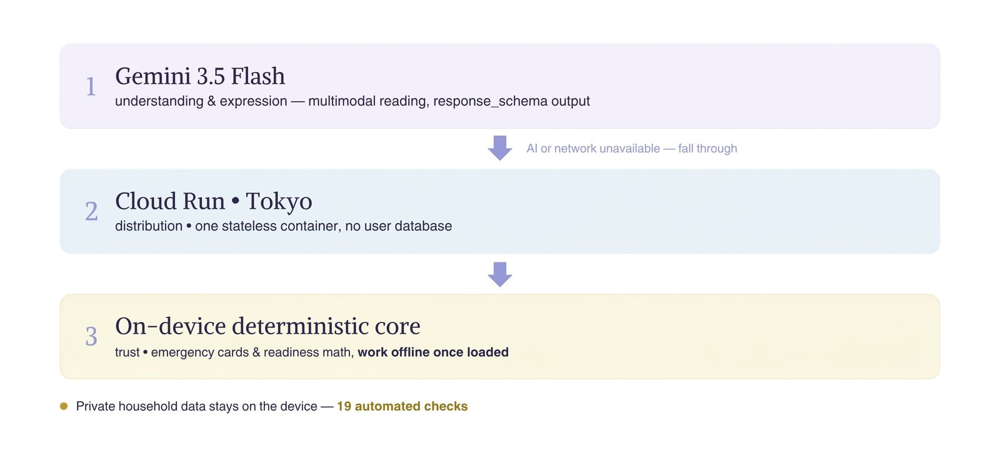
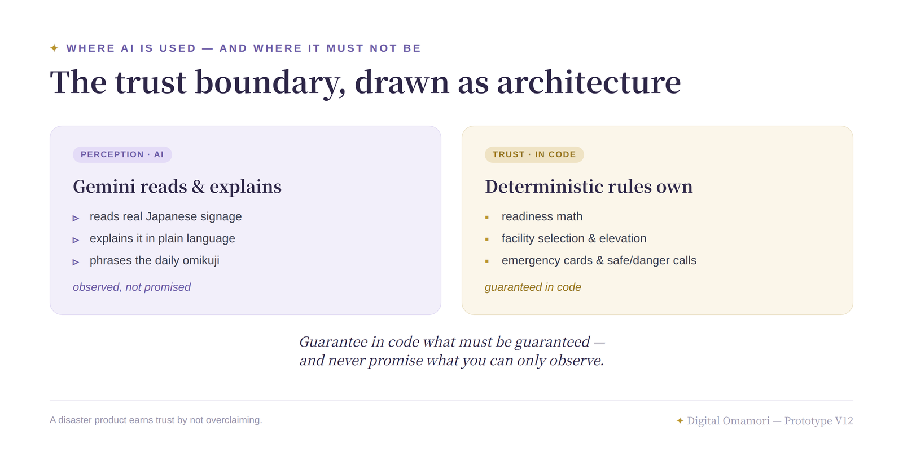

# Digital Omamori

**A local-first disaster decision companion for foreign residents in Japan.**
Bilingual UI — English + やさしい日本語 (Easy Japanese with furigana).

Built for the Google Cloud × Hack2skill Gen AI Academy APAC Edition hackathon — Cohort 2, Track 1 (*AI-Powered Decision Intelligence Platform*), challenge: *AI for Better Living and Smarter Communities*. Prototype V12. Selected for the **Top 10** and placed **2nd at the Virtual Grand Finale** (August 2026).

> **About this repository — public showcase edition.**
> Source-visible showcase of Prototype V12: the server, security hardening, AI proxy design, engine API surface, data schemas and deployment setup are real. The UI, engine implementations, prompts, processed data and test suites are withheld (see [`WITHHELD.md`](WITHHELD.md)), so it is not runnable as a product.
> **All rights reserved — not open source.** See [`LICENSE`](LICENSE).

## Why This Matters

When a disaster hits Japan, many signs, alerts, and official notices are Japanese-first. For the 4M+ foreign residents in the country, readiness is not a calculation problem — it is a **decision problem**: *What does this sign mean? What should I do next? Where do I go when the network is down?*

A foreign resident in Japan cannot pause an earthquake to translate a notice or open a spreadsheet of shelter locations. Digital Omamori removes that friction. Point your camera at a Japanese safety sign. Check what your household still needs. Use saved local data for nearby support points, even when live AI is unavailable after load. It turns messy, Japanese-first disaster information into clear, bilingual next steps.

Foreign residents in Japan are a dispersed minority community with shared preparedness barriers, so Digital Omamori works **household by household**. When each household becomes better prepared, the wider community becomes more resilient — self-reliance, one family at a time.

## Demo & Links

- **Live deployment:** https://digital-omamori-554364795398.asia-northeast1.run.app (Cloud Run, asia-northeast1 / Tokyo)
- What is and isn't in this repository → [`WITHHELD.md`](./WITHHELD.md)

## What Changed in Refinement (V11 → V12)

> The rule that decided every change: **when uncertainty can be removed from the critical path, we remove it — instead of adding another layer to manage it.** This phase added no new features. We took the prototype to real Tokyo streets and redesigned around what we saw — every change below traces to a field observation.

- **Point-and-frame targeting for Lens — the promise from our first submission, shipped.** By default Lens reads the whole scene; tap the preview to place a frame on the one notice that matters — move it, resize it, or ✕ it away. With a frame active, only the framed region reaches Gemini — ATM stickers, hotline posters and ads outside it are cropped out of the model's input rather than prompt-managed. Honest scope, unchanged since the first submission: *multi-sign handling is improved through user framing (committed); automatic detection of the disaster-relevant sign remains under exploration.*
- **Capture rebuilt for the street.** Zero-shutter capture — what you aim at is what gets read; a viewfinder that behaves like a camera, not a web page (drag to aim, no page scroll, guidance above the lens); and faster reads in the field, because the frame's crop replaced a heavy high-resolution processing pass. An intermediate sensor-still path was reverted after a street test caught its shutter lag.
- **Honest failure states.** Timeouts, oversized images and model errors are no longer collapsed into "offline", and the user is never told to "find better signal" in a disaster context. Recovery is unambiguous: *Send this photo* (retry) vs *Retake* (new shot). Genuinely offline, Lens pauses honestly and hands off to Emergency Mode; the status pill follows a strict priority — real **Offline** always wins over the demo toggle's **Offline mode**.
- **Navigation redesigned around the thumb.** Every slot now carries an icon above its label (icon + label, never icon-only), and Lens sits dead-center as a distinct round button — the hero feature under the thumb's natural resting point.
- **A final rendering polish.** Kanji and kana now share one baseline across buttons, pills and titles, and rapid taps on buttons no longer trigger iOS double-tap zoom (page pinch-zoom stays available).
- **An independent integrity review, merged after test-gated batches.** Its fixes are the same rule applied inward: expired supplies can no longer satisfy readiness coverage (an inflated readiness number is the one bug that can genuinely hurt someone); an AI-unavailable Lens never fabricates (a leftover demo fixture was removed); furigana rendering was rebuilt with DOM nodes only; failed local saves no longer claim "Saved" (the editor stays open); and the Lens request lifecycle was hardened so a stale response can never overwrite a newer result.
- **What we removed.** A partially-built Lens × household-inventory card (one hard-coded scenario) was removed rather than shipped inconsistent; the full connection returns post-competition as a complete, field-verified feature. Removing half-done work is this project's habit, not an exception — see V9's endpoint removals and V11's percentage removal below.

`_lens_prompt` — the Lens reading instruction, including its honest refusal on non-notices — was deliberately left untouched this phase.

## Key Capabilities

- **Lens — read the sign, get the action.** Photograph a Japanese disaster notice or safety sticker. Gemini reads the selected image and returns *For My Brain* and *For My Action* cards; the browser then appends deterministic nearby support points, water stations, and elevation from locally loaded public data. If AI is unavailable, Lens pauses explicitly instead of showing a fabricated sample reading.
- **Ready Check (備えチェック) — public guidance and clearly labeled common-preparedness rules → your household's targets.** Enter your family size; the app converts public preparedness guidance into concrete stock targets. **Deterministic rules decide what counts as "ready"** — free-form extra items can never inflate the number.
- **Nearby (周辺ビュー) — the support view you need, on device.** Nearest evacuation shelters, AEDs, and water supply points, with distance, direction, and per-facility elevation for any saved place, from local data.
- **Emergency Mode — keeps working when the network drops (once the app and its local data have loaded).** Uses locally loaded facility and decision-template data together with the household inventory stored on device: your nearest support point, what to bring, and what to check before you move.
- **Ready-Kuji (御神籤) — a daily readiness habit.** The tier comes from your real readiness. Gemini phrases the message; 20 prewritten slips serve offline.

**Trust boundary:** Deterministic code owns household targets, readiness coverage, facility selection, distance and direction, elevation facts, and Emergency Mode cards — using bundled public data, clearly labeled preparedness rules, and on-device household records, never generative AI. Gemini is used for **perception and expression**: reading the sign the user photographed (*For My Brain* / *For My Action*) and phrasing the daily omikuji. Lens relies solely on the image the user selected — deterministic nearby support data is appended separately by the browser. Omikuji failures fall back to 20 static slips; Lens failures stop with an explicit error and never substitute a fabricated reading.

**Where each input becomes a card:**

- **What's around you** — a photo of a sign → Lens dual cards (*For My Brain* / *For My Action*)
- **What's official** — bundled public data (Minato City, Tokyo Waterworks, GSI) → support points near you + elevation
- **What's at home** — your household inventory → Ready Check gap cards + the daily omikuji

## Architecture






```
User — browser PWA (camera · text · offline-capable once loaded)
  │
  ├── Local-first layer (on device, no network needed after load)
  │     • Household records in localStorage: profile, inventory, saved places, readiness
  │     • Deterministic core (app/core.js): coverage engine, category matching,
  │       distance/direction, card-building logic
  │     • Bundled datasets (JSON) — public-data derivatives: 311 facilities
  │       + GSI-derived elevation; app-authored content & rules: 20 omikuji
  │       slips, decision templates, preparedness catalog, seed defaults
  │     → household facts, readiness numbers, facility lists, and Emergency Mode
  │       cards are deterministic — never AI-invented
  │
  └── Cloud Run — Python container (asia-northeast1)
        ├── Serves the app + public municipal data; receives only explicit AI requests
        │     (the user-selected Lens image, or a coarse Kuji tier — household records stay on device)
        └── Gemini 3.5 Flash on Google Cloud (attached service account — no key in the image)
              • Lens: Japanese sign → plain-English summary + easy-Japanese action
              • Ready-Kuji: phrases the daily message (easy-JP + furigana required by prompt, with limited deterministic output guards)
```

Three layers of resilience: **Gemini** for multilingual understanding → **Cloud Run** for distribution → a **local deterministic layer** that keeps working with no AI and no network once the page has loaded.

## Engineering Story: An Honest Number Beats a Comfortable One

In a disaster app, the most dangerous bug is not a crash — it is **false reassurance**.

An earlier build's Today ring and omikuji read a kit "usable %" that ignored whether each stocked item actually met its target. It showed **91% ready** while true household coverage was far lower. The root cause was in the demo seed, not the engine: each seeded item's `targetQuantity` had been hand-set equal to its `quantity`, which quietly bypassed the deterministic `resolveTarget(rule, family)` calculation the live add-flow uses — so every stocked item was marked "sufficient" by default.

**V11 fixed it at the data layer, with no change to the coverage logic itself.** A realistic seed — 23 photographed items across the core readiness categories (including two expired items, to exercise the rotation reminder) — replaces the MUJI demo dummy, and its targets are computed by the same `resolveTarget` the app uses. Today, omikuji, and Ready Check now all read one `computeCoverage()` number.

The readiness percentage dropped — **honestly**. That is the point: in a preparedness tool, a number that overstates safety is worse than a lower, true one. The fix made the honesty principle structural rather than cosmetic.

Then we removed the number that started it all. Even after the seed fix, My Emergency Kit still carried a percentage of its own — how many logged items were individually "fine". Honest or not, a percentage sitting beside Ready Check's coverage number reads as a *second* answer to "how prepared am I?", and the higher one wins the user's attention. So the kit header dropped its percentage entirely: it now shows plain inventory counts — items on hand, how many are expiring, how many are running low — and Ready Check owns the single readiness number. The lesson generalized: **when a number invites the wrong reading, a count beats a percentage.** A header that reads *"23 items · 2 expiring · a few running low"* cannot be mistaken for *"you are 23% safe."*

## Engineering Highlights

- **Coverage integrity.** Readiness counts only the save-time classification, so free-form "Extra" items can never silently inflate the ready percentage.
- **Two-layer category matching.** User-chosen category → keyword ranking within it, preventing cross-category pollution; over-broad keywords were narrowed (e.g. *watermelon* → water, *toilet paper* → portable toilet).
- **Privacy by design.** Private household data stays in the browser and is never POSTed to the backend; omikuji sends only a coarse readiness tier; Lens sends only the image the user chose. Enforced by an automated **dataflow suite (19 checks)** that fails if a prohibited household field ever appears in a client request.
- **AI output guards.** Easy Japanese and furigana are required by prompt and protected by deterministic schema, length, required-field and banned-pattern checks (e.g. ましょう). Kuji failures fall back to one of 20 static slips; Lens failures stop with an explicit error rather than substituting a fabricated reading.
- **Honest facility data.** The AED open-data source has no English column, so app-generated names live in a separate field with a `＊` label — official names are never overwritten.
- **Server hardening.** Directory listing → 404, static-file allowlist, source paths → 404, body/image size caps, MIME allowlist, application-level rate limiting on AI endpoints.

## Tech Stack

| Component | Technology |
|-----------|------------|
| Frontend | Single-page installable PWA (`index.html` + `app/core.js`); self-uninstalling cache-cleanup service worker |
| Backend | Python container (`server.py`) |
| Model | Gemini 3.5 Flash |
| Deployment | Google Cloud Run — `asia-northeast1` (Tokyo) |
| Auth | Attached service account / ADC (no key file in the image) |
| Public data | 311 Minato City facilities + GSI elevation |
| Household records | Browser `localStorage` — never uploaded. Explicit AI inputs: the user-selected Lens image, or a coarse Kuji tier |
| Quality gates | 132 primary tests (67 core + 45 dashboard + 20 server) + 19 dataflow + 13 vocab-lint = **164 checks** |

## Repository Structure

```
.
├── server.py            # Static serving + AI proxy + hardening (prompts / normalizers withheld)
├── storage.py           # Read-only local / GCS adapter
├── app/core.js          # Deterministic engine: public API + geography helpers (engine bodies withheld)
├── schema/              # Sample records showing the data schemas (placeholder values)
├── docs/images/         # Architecture diagrams
├── Dockerfile · requirements.txt
├── WITHHELD.md          # What is not included, and why
└── LICENSE              # All rights reserved (source-visible)
```

## Lessons Learned

- **False reassurance is the bug.** In a preparedness app, an inflated readiness number is more dangerous than an honest low one. We shipped the lower, true number.
- **AI for perception, deterministic code for safety.** Keep Gemini for understanding and expression; keep every safety-critical fact, number, and Emergency Mode card deterministic. Elevation reports facts and never judges "safe" or "dangerous".
- **Privacy is an architecture decision, not a policy line.** Keeping household records in the browser reduces backend exposure, and an automated dataflow test checks that the client does not silently upload them.
- **Generation needs a guardrail.** Constrain AI output to easy-Japanese with furigana and deterministically guard common schema, length, required-field and banned-pattern failures — detected Kuji failures fall back to static slips; detected Lens failures stop with an explicit error.

---

## Data Sources & Attribution

This prototype reorganizes public open data into its own schema (renaming fields, filtering, adding English fallbacks, merging elevation). All entries are **processed derivatives** — in Japanese, *加工して作成*, the wording each provider's terms of use require. None require prior application or an approval number; attribution only.

The Japanese attribution text below is kept verbatim because it is the legally required form of citation; the English line summarizes it for reviewers.

**Minato City Open Data** — evacuation shelters (区民避難所・福祉避難所情報, with official English names & furigana) and AED locations (AED設置場所).

> 出典：港区オープンデータカタログサイト（区民避難所・福祉避難所情報、AED設置場所）https://opendata.city.minato.tokyo.jp/ ／防災データ一覧 https://www.city.minato.tokyo.jp/opendata/bousai/index.html （2026年6月に利用）を加工して作成。港区オープンデータ利用規約（CC BY 4.0 互換）に基づき利用。

*Minato City Open Data, processed. CC BY 4.0 compatible.*

**Tokyo Metropolitan Government Open Data Catalog** — disaster water supply stations (Bureau of Waterworks).

> 出典：東京都水道局「給水拠点一覧データ」（東京都オープンデータカタログサイト）https://catalog.data.metro.tokyo.lg.jp/dataset/t000019d0000000001 （資料日 2025-12-11）を加工して作成。クリエイティブ・コモンズ 表示4.0 国際（CC BY 4.0）で提供されています。

*Tokyo Waterworks via Tokyo OpenData Catalog, processed. CC BY 4.0.*

**Geospatial Information Authority of Japan (GSI)** — per-facility elevation (T.P.), computed from GSI elevation tiles (DEM).

> 標高データ：国土地理院 標高タイル（基盤地図情報 数値標高モデル DEM）を使用。出典：国土地理院（https://maps.gsi.go.jp/development/ichiran.html ）各施設の海抜(T.P.)は同標高タイルより算出（加工して作成）。※ 地理院タイルのリアルタイム利用のため、測量法上の複製・使用承認申請は不要（出典明示のみ）。

*GSI elevation tiles, processed. Attribution only; no survey-act approval required for real-time tile use.*

**Preparedness guidance** — recommended stock amounts are based on public guidance; items without an official per-item source are labeled **"Common preparedness" (一般)** in-app, so official guidance is always distinguished from common practice.

- 内閣府「避難所におけるトイレの確保・管理ガイドライン」(2016) — portable toilet: 5 uses/person/day
- 経済産業省「トイレ備蓄 忘れていませんか」 — 35 uses/person = 7 days
- 首相官邸「災害が起きる前にできること」 · 農林水産省「災害時に備えた食品ストックガイド」 · 東京備蓄ナビ（東京都）

## Roadmap (honest: none of this is built yet)

- **Multilingual expansion** — Chinese, Tagalog, Vietnamese and more for Japan's foreign residents. Ships only with a translation-verification step: expression is translated, official facts (place names, elevations, facility names) are never rewritten.
- **Photo-based inventory capture** — point the camera at a product, Gemini identifies it, **the user confirms before anything is saved**. In a disaster app a misfiled item feeds a false readiness score, so this ships with a human-in-the-loop gate or not at all.
- **Visitor mode** — a lightweight profile for travelers who need sign understanding and local support points without household inventory setup.
- **Family safety check-in** — disaster-triggered only, never an everyday tracker: an alarm that cries wolf every Tuesday will be ignored on the one day it matters. Passive opt-in signals, and humans — not the app — decide whether to act.
- **Lens × household inventory** — Lens will connect what it sees to what you own ("you have a water tank in the entryway — bring it"). We removed a partially-built version of this rather than ship an inconsistent one; it returns as a complete, field-verified feature.

Each item follows the same rule as the rest of Digital Omamori: deterministic where lives depend on it, AI where understanding helps, and nothing shipped that pretends to be more than it is.

## Version History

| Version | Date | Milestone |
|---------|------|-----------|
| **V12** | 2026-07-20–26 | Refinement round: point-and-frame Lens targeting (whole-scene default → tap to frame / move / resize), zero-shutter capture, honest error taxonomy + offline pause, thumb-centered navigation (Lens as the center round button), independent integrity review merged (expired stock never counts toward coverage; AI-off Lens never fabricates; DOM-safe furigana), partial Lens×inventory card removed. |
| **V11** | 2026-07-06 | Coverage-consistency + realistic photographed seed (honest readiness numbers). |
| **V10** | 2026-07-04–05 | Mobile UX overhaul; bottom navigation; one-screen Lens camera; language-independent layout; vocabulary-lint suite; English pass over developer-facing docs. |
| **V9** | 2026-06-30–07-02 | Submission/credibility QA + privacy by design: private household data moved to the browser (localStorage), never persisted to the backend. |
| **V8** | 2026-06-30 | Rebrand to Digital Omamori + source-trust badges, citations, full furigana. |
| **V7** | 2026-06-25 | Lens multimodal: photograph a notice → summary + easy-Japanese action, paired with local data. |
| **V6** | 2026-06-23 | Ready-Kuji (disaster omikuji) + Gemini wiring (gemini-3.5-flash / service-account ADC). |
| **V4–V5** | 2026-06-21 | Coverage-matching engine + all 311 Minato City facilities with real coordinates + GSI elevation. |
| **V1–V3** | 2026-06-20 | Prototype skeleton → real management app (server + JSON CRUD + PWA) → recommendation engine. |


## License

Copyright (c) 2026 Meredith Cheung (nullinbetween). **All rights reserved.**
This repository is source-visible for reference only and is **not open source**. No permission is granted to copy, modify, redistribute, deploy, or use it (including for AI training) without prior written permission. See [`LICENSE`](LICENSE).

Facility names, coordinates, and official English names in the live app retain the open-data provenance above; processed data is never presented as if published by Minato City, the Tokyo Metropolitan Government, or GSI. Digital Omamori is an independent project and is not affiliated with or endorsed by Minato City.
